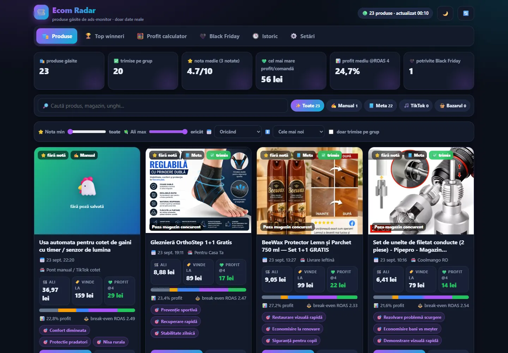
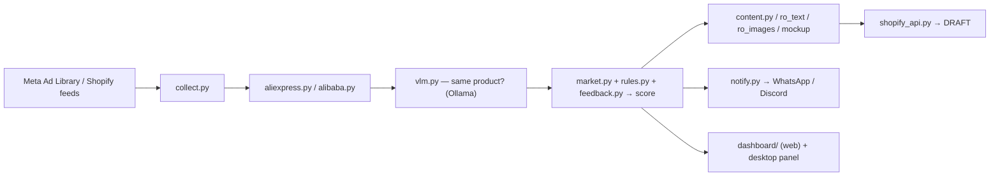
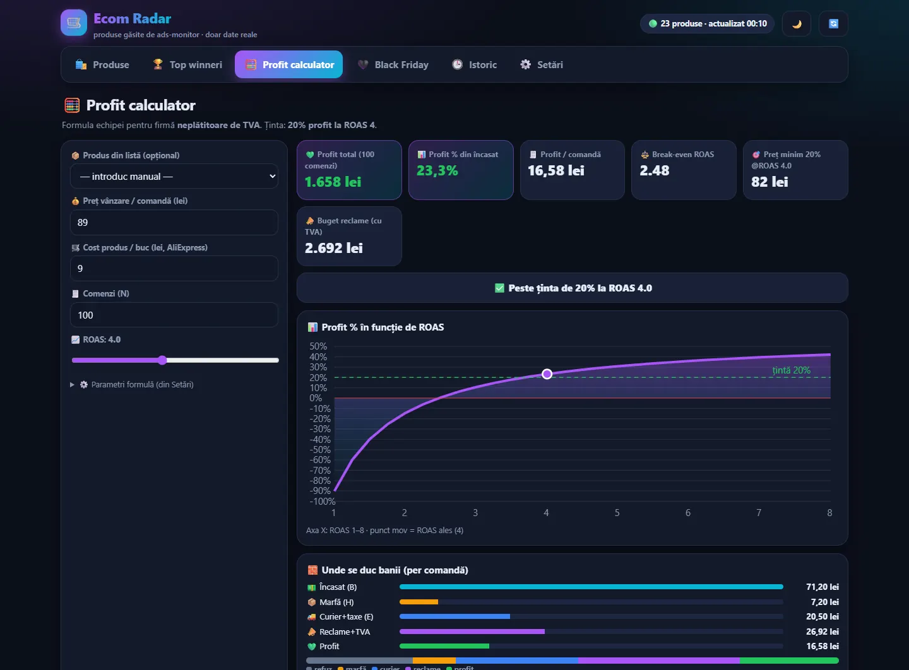
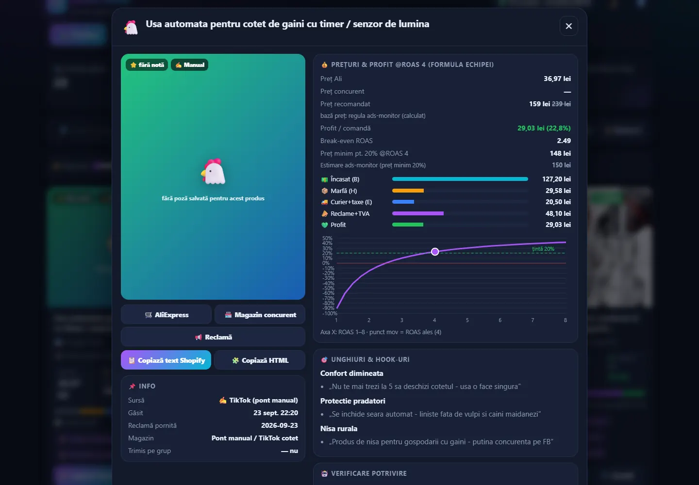

<div align="center">

<div style="font-size:64px">🛰️</div>

# Ecom Radar

**Daily product research on autopilot: ads → supplier match → margin score → Shopify draft. A human still decides.**

  <a href="https://github.com/LucianCeusanRo/ecom-radar/actions/workflows/ci.yml"></a>
  <a href="LICENSE"></a>
  
  <a href="https://github.com/LucianCeusanRo/ecom-radar/stargazers"></a>
  <a href="https://github.com/LucianCeusanRo/ecom-radar/commits/main"></a>

[English](#-about) · [Română](#-română)

</div>

<p align="center"></p>

## 📑 Table of contents

- [📖 About](#-about)
- [✨ Features](#-features)
- [🧠 How it works](#-how-it-works)
- [⚡ Quick start](#-quick-start)
- [📚 Step-by-step tutorial](#-step-by-step-tutorial)
- [🖼️ Screenshots](#-screenshots)
- [🔧 Configuration](#-configuration)
- [🗂️ Project structure](#-project-structure)
- [⚠️ Limitations](#-limitations)
- [❓ FAQ](#-faq)
- [🗺️ Roadmap](#-roadmap)
- [🤝 Contributing](#-contributing)
- [📄 License](#-license)
- [🇷🇴 Română](#-română)
- [👤 Author](#-author)

## 📖 About

A local Python pipeline that finds products other Romanian stores are advertising, checks whether they can be sourced cheaply, scores them, and prepares listings. It was built to replace manual product research for a small cash-on-delivery Shopify store.

- **Used for:** every morning, instead of scrolling the Ad Library and AliExpress by hand for hours, the pipeline brings a short list of products that Romanian stores are actively advertising, with the supplier price, the estimated margin, a score and a ready-made draft page. A person still decides what gets published.
- **Helps:** small Romanian dropshipping / cash-on-delivery (COD) stores and solo e-commerce operators who do product research themselves; also useful as an example of a scraping + LLM pipeline with strict safety limits.

## ✨ Features

- ✨ **Ad collection** from the public Meta Ad Library (`meta-ads-collector`), rotating Romanian keywords plus PL/HU markets; fallback to new products from public Shopify `/products.json` feeds when Meta rate-limits.
- 🔎 **Supplier matching:** image search on AliExpress with Playwright (Edge), Alibaba as a fallback, and a local vision model (Ollama) that confirms "same product?".
- ⚙️ **Scoring:** margin and break-even ROAS calculation, eMAG saturation check, "rising product" detection from ad history, audience weights, and team feedback rules.
- 📊 **Content:** Romanian product page text (LLM), translated product images (OCR + redraw), Romanian infographics and a phone mockup.
- 🛡️ **Shopify drafts** through the Admin API (client-credentials token refreshed automatically), never published automatically.
- 🧩 **Notifications** to a WhatsApp group (via the OpenClaw CLI) and optionally Discord.
- 🌐 **Dashboard:** a web view (`dashboard/app.html`, also served by an optional FastAPI route) with products, top winners, profit calculator, history and settings, plus a Tkinter desktop control panel (`desktop/ecom_control.pyw`).
- 🧪 **Safety:** stops after repeated captchas/blocks, cooldowns per source, already-checked products are cached; secrets are read only from local files or environment variables.

## 🧠 How it works



`run.py` orchestrates every stage. Each stage has cooldowns and stops after repeated blocks; products already checked are cached; nothing is ever published automatically.

**Tech stack:** Python 3.11+, Playwright, curl_cffi, requests, Ollama, Gemini (Claude optional via a local CLI), RapidOCR, Pillow, FastAPI, Tkinter, Shopify Admin GraphQL API, PowerShell.

## ⚡ Quick start

```bash
git clone https://github.com/LucianCeusanRo/ecom-radar.git && cd ecom-radar
python -m venv .venv && .venv/bin/pip install -r requirements.txt
python -m playwright install msedge
cp .env.example .env && python selftest.py
python run.py --target none --limit 5      # dry run, sends nothing
```

## 📚 Step-by-step tutorial

### 1. Install
```bash
git clone https://github.com/LucianCeusanRo/ecom-radar.git && cd ecom-radar
python -m venv .venv && .venv/bin/pip install -r requirements.txt   # Windows: .venv\Scripts\pip
python -m playwright install msedge   # or change BROWSER_CHANNEL in config.py
# optional local vision model for supplier matching:
ollama pull <vision-model>            # set VLM_MODEL in config.py to the model you pulled
```
### 2. Configure `.env`
```bash
cp .env.example .env
```
Fill in only what you use, then export the variables (the code reads environment variables):
- `GEMINI_API_KEY` — text generation (or put it in `gemini_api_key.txt`).
- `SHOPIFY_SHOP`, `SHOPIFY_ADMIN_STORE`, `SHOPIFY_CLIENT_ID` + `shopify_client_secret.txt` — only if you want Shopify drafts.
- `ECOM_WA_GROUP_TEST` / `ECOM_WA_GROUP_PROD` — WhatsApp group IDs for the OpenClaw CLI; `discord_webhook.txt` for Discord.
- `meta_adlib_token.txt` — optional Meta Ad Library API token.
All `*.txt` secret files and `.env` are git-ignored.
### 3. Run safely first
```bash
python selftest.py                    # checks every stage without sending anything
python run.py --target none --limit 5 # dry run: prints results, sends nothing, creates nothing
python run.py --target none --cache   # re-use ads collected in the last 24 h (no Meta requests)
```
### 4. Typical daily walkthrough
1. `python run.py --target test` — sends the results to your *test* group only.
2. `python dashboard/build_data.py` and open `dashboard/index.html` (or the login-protected `/ecom` route if you mount `dashboard/ecom_routes.py` in a FastAPI app): browse products, top winners, the profit calculator and history.
3. Write down what the team liked or rejected: `python feedback.py add "no clothing with sizes"` — the rules are given to the model when it scores new products, so it stops proposing the same kind of rejected product.
4. Products with a high enough score become **draft** products in Shopify; you review the text and images and publish manually.
5. When you trust it: `python run.py --target prod`, and schedule it daily on Windows with `powershell -ExecutionPolicy Bypass -File register_task.ps1`.
6. Tune thresholds (margin, days of ads, audience weights…) from the dashboard settings or `desktop/ecom_control.pyw`; defaults live in `config.py` / `settings.py`.

Working notes (Romanian) are in [`docs/NOTES_RO.md`](docs/NOTES_RO.md).

## 🖼️ Screenshots

| Profit calculator | Product detail |
| --- | --- |
|  |  |

## 🔧 Configuration

Copy `.env.example` to `.env` and export the variables. File-based secrets (`shopify_client_secret.txt`, `discord_webhook.txt`, `meta_adlib_token.txt`, `gemini_api_key.txt`) are git-ignored.

| Variable | Required | What it does |
|---|---|---|
| `GEMINI_API_KEY` | for AI text | text generation and scoring |
| `SHOPIFY_SHOP / SHOPIFY_ADMIN_STORE / SHOPIFY_CLIENT_ID` | for drafts | Shopify Admin API (plus `shopify_client_secret.txt`) |
| `SHOPIFY_VENDOR` | no | vendor name on draft products |
| `ECOM_STORE_NAME` | no | store name shown in the phone mockup |
| `ECOM_WA_GROUP_TEST / ECOM_WA_GROUP_PROD` | for WhatsApp | group IDs used by the OpenClaw CLI |
| `ADS_MONITOR_DIR` | no | input folder for `dashboard/build_data.py` |
| `ECOM_DASH_URL` | no | dashboard link put in notifications |

## 🗂️ Project structure

```
run.py, selftest.py          entry points (pipeline, self-test)
collect.py, metaapi.py, metapool.py, shopfeed.py   ad / feed collection
aliexpress.py, alibaba.py, vlm.py                  supplier search + vision check
market.py, rules.py, feedback.py, examples.py      scoring and learning from feedback
content.py, page.py, ro_text.py, ro_images.py, mockup.py   listing content
shopify_api.py, notify.py, llm.py, errors.py       integrations and helpers
config.py, settings.py       all tunables
dashboard/                   app.html, build_data.py, FastAPI routes
desktop/ecom_control.pyw     Tkinter control panel
register_task.ps1            Windows Task Scheduler setup
```

## ⚠️ Limitations

- Built and tested on **Windows** (Edge, Task Scheduler, PowerShell); Linux/macOS need small path and browser changes.
- Scraping AliExpress / Alibaba / Meta is fragile: layouts change, captchas appear and limits apply — the pipeline stops after repeated blocks instead of insisting. Respect each site's terms.
- Margins are estimates (supplier price, shipping, ad cost assumptions in `config.py`); verify before buying stock or spending on ads.
- Texts and images are tuned for the Romanian market and Romanian language.
- WhatsApp notifications depend on the third-party OpenClaw CLI being installed and logged in.

---

## ❓ FAQ

<details><summary><b>Will it publish products to my store?</b></summary>

No. It only creates **draft** products; you review and publish manually.

</details>

<details><summary><b>Do I need paid AI?</b></summary>

No. Providers run in order Gemini → local Ollama → rules only (`--no-ai` forces rules).

</details>

<details><summary><b>Does it run on Linux/macOS?</b></summary>

It was built on Windows; other systems need small path and browser changes.

</details>

<details><summary><b>How do I test without sending messages?</b></summary>

`python selftest.py` and `python run.py --target none`.

</details>

## 🗺️ Roadmap

- [ ] Linux/macOS support
- [ ] More marketplaces for saturation checks
- [ ] Unit tests for scoring rules

## 🤝 Contributing

Issues and pull requests are welcome. Please keep changes small, describe how you tested them, and never commit real credentials — use `.env` (git-ignored) and update `.env.example` with placeholders only.

## 📄 License

MIT — see [LICENSE](LICENSE).

## 🇷🇴 Română

<details>
<summary><b>Click pentru versiunea în limba română</b></summary>

Un pipeline local în Python care găsește produsele pentru care alte magazine din România fac reclamă, verifică dacă pot fi aduse ieftin, le dă o notă și pregătește listările. A fost făcut ca să înlocuiască cercetarea manuală de produse pentru un magazin Shopify mic, cu plata la livrare.

#### Funcționalități
- **Colectare reclame** din Meta Ad Library (public), cu rotație de cuvinte cheie în română și piețele PL/HU; rezervă din feed-urile publice Shopify când Meta limitează cererile.
- **Potrivire cu furnizori:** căutare după poză pe AliExpress cu Playwright (Edge), Alibaba ca rezervă, și un model de vedere local (Ollama) care confirmă „același produs?”.
- **Notare:** marjă și ROAS de break-even, verificare saturare pe eMAG, detectare produse „în creștere”, ponderi de public și reguli învățate din feedback-ul echipei.
- **Conținut:** text de pagină în română (LLM), poze traduse în română (OCR + redesenare), infografice și mockup de telefon.
- **Drafturi Shopify** prin Admin API (token reînnoit automat), niciodată publicate automat.
- **Notificări** pe un grup de WhatsApp (prin OpenClaw) și opțional Discord.
- **Dashboard:** interfață web (`dashboard/app.html`, servită opțional printr-o rută FastAPI) cu produse, top câștigători, calculator de profit, istoric și setări, plus un panou desktop Tkinter.
- **Siguranță:** se oprește după blocări/captcha repetate, pauze per sursă, cache pentru produsele verificate; secretele se citesc doar din fișiere locale sau variabile de mediu.

#### La ce folosește și pe cine ajută
- **Folosește la:** în fiecare dimineață, în loc de ore de căutat manual prin Ad Library și AliExpress, primești o listă scurtă de produse promovate activ în România, cu prețul de la furnizor, marja estimată, nota și o pagină draft gata făcută. Decizia de publicare rămâne la om.
- **Ajută:** magazinele mici de dropshipping / plata la livrare și pe cei care își fac singuri cercetarea de produse.

#### Arhitectură și tehnologii
Colectare reclame → căutare furnizor + verificare cu model de vedere → notare (marjă, ROAS, saturare eMAG, trend, reguli) → conținut în română → draft Shopify + notificări + dashboard (vezi diagrama de mai sus). Python 3.11+, Playwright, curl_cffi, requests, Ollama, Gemini / Claude, RapidOCR, Pillow, FastAPI, Tkinter, Shopify Admin API, PowerShell.

#### Tutorial
1. **Instalare:** `python -m venv .venv`, `pip install -r requirements.txt`, `python -m playwright install msedge`; opțional Ollama cu un model de vedere (setezi `VLM_MODEL` în `config.py`).
2. **Configurare:** `cp .env.example .env`; completezi doar ce folosești (`GEMINI_API_KEY`, datele Shopify, ID-urile grupurilor WhatsApp, fișierele `*.txt` cu secrete — toate ignorate de git) și exporți variabilele.
3. **Probă:** `python selftest.py`, apoi `python run.py --target none --limit 5` (nu trimite și nu creează nimic).
4. **Zilnic:** `python run.py --target test` → `python dashboard/build_data.py` și deschizi dashboard-ul → notezi ce a respins echipa cu `python feedback.py add "…"` (regulile sunt date modelului la notare) → produsele cu notă mare apar ca **draft** în Shopify, le verifici și le publici manual → când ai încredere, `--target prod` și programare cu `register_task.ps1`.

Notele de lucru detaliate sunt în [`docs/NOTES_RO.md`](docs/NOTES_RO.md).

#### Structura proiectului
Vezi lista de mai sus (`run.py`, module pe etape, `dashboard/`, `desktop/`, `config.py` / `settings.py`).

#### Limitări
- Făcut și testat pe **Windows**; pe Linux/macOS trebuie mici ajustări.
- Scraping-ul e fragil (pagini schimbate, captcha, limite); pipeline-ul se oprește după blocări repetate. Respectă termenii fiecărui site.
- Marjele sunt estimări; verifică înainte să cumperi stoc sau să plătești reclame.
- Textele și imaginile sunt pentru piața din România.
- Notificările WhatsApp depind de OpenClaw CLI instalat și conectat.

</details>

## 👤 Author

**Lucian-Ciprian Ceușan** — telecom & network technician, Bucharest, Romania

[](https://lucian-ceusan.vercel.app) [](https://www.linkedin.com/in/lucian-ceusan-7a9179210) [](https://github.com/LucianCeusanRo)
